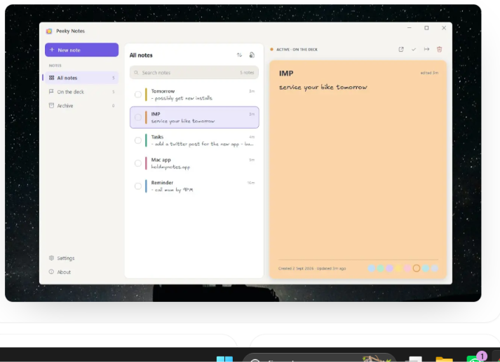

# Peeky Task Web
### Official promotional website & landing page for Peeky Task.

**[→ Try it live](https://github.com/Pro-Prince/peeky-task-web)**

---

## Overview

Peeky Task Web is the official promotional website and interactive web showcase for **Peeky Task**, the minimalist screen-edge floating daily task and to-do widget for Windows 10 & 11. Designed with dark aesthetics, glassmorphism UI components, responsive layout previews, interactive color pickers, and live product feature showcases, the site provides everything visitors need to discover, explore, and download Peeky Task. Built with Next.js 16 (App Router), React 19, and Tailwind CSS.

---

## App Preview

> Experience interactive widgets, live color switching, and product walkthroughs directly in the browser.

---

## Features

- **Hero & Live Widget Demonstration** — interactive mockups showing the rested 7px edge slivers expanding into sticky task tabs on hover
- **Dynamic Color Showcase** — live preview of Peeky Task's signature pastel palette (Mint, Sky, Butter, Peach, Blush, Lilac, Blue, and Slate)
- **Interactive FAQ Accordion** — comprehensive product questions with smooth expanding drawers and keyboard accessibility
- **Product Walkthrough & Screenshots** — showcase of the First-Launch Onboarding Flow, formatting toolbars, and task management dashboard
- **Fully Responsive & Dark-Themed** — handcrafted with Tailwind CSS, optimized for desktop, tablet, and mobile viewports
- **SEO & Social Metadata Ready** — Open Graph tags, Twitter card tags, and semantic HTML structure for optimal discovery

---

## Tech Stack

| Technology | Role |
|---|---|
| Next.js 16 | React application framework and static page generation |
| React 19 | Declarative component UI engine |
| TypeScript | Type safety and maintainable codebase |
| Tailwind CSS | Utility-first CSS styling and dark theme tokens |
| Lucide React | Modern iconography |
| Turbopack | Next-generation ultra-fast bundler |

---

## Architecture

- **App Router Architecture:** Modern Next.js App Router structure with dedicated routes for landing (`/`), changelog (`/changelog`), privacy (`/privacy`), and terms (`/terms`).
- **Static Generation (SSG):** All marketing pages are statically compiled with Turbopack for sub-second page loads and zero server latency.
- **Component Choreography:** Self-contained UI components for hero, interactive widget demonstrations, pricing tiers, and FAQ accordions.

---

## Challenges Solved

**1. Simulating native Windows desktop widgets on the web**
Demonstrating how a screen-edge desktop widget feels inside a standard browser page required mimicking OS bezel interactions. Created interactive preview stages that respond to hover states just like the native Windows application.

**2. Smooth accordion and swatch interactions without heavy dependencies**
Avoided heavy third-party UI libraries by building lightweight, accessible accordion drawers and color switchers using pure React state and Tailwind CSS transitions.

**3. High-performance static builds**
Optimized bundle sizes and asset loading to ensure the landing page scores top marks on Lighthouse performance metrics.

---

## Related Repositories

- **[Peeky Task Desktop App](https://github.com/Pro-Prince/peeky-task-app)** — The Windows 10 & 11 floating desktop application built with Electron.

---

## Author

**Prince Patel** — AI-Powered Product Developer

- 🌐 Portfolio: [prince-patel-portfolio.vercel.app](https://prince-patel-portfolio.vercel.app)
- 🐙 GitHub: [github.com/Pro-Prince](https://github.com/Pro-Prince)
- 𝕏 X: [@Pro_Prince_1](https://x.com/Pro_Prince_1)
- 💼 LinkedIn: [linkedin.com/in/prince-patel476](https://www.linkedin.com/in/prince-patel476/)

---

## License

This project is licensed under the MIT License.
